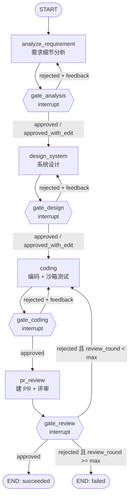
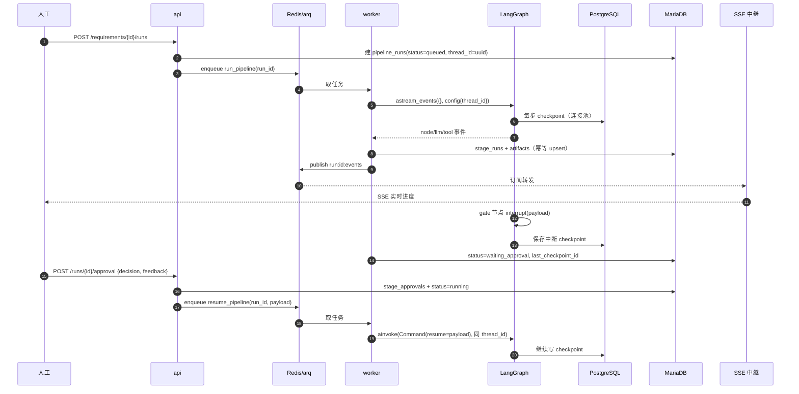
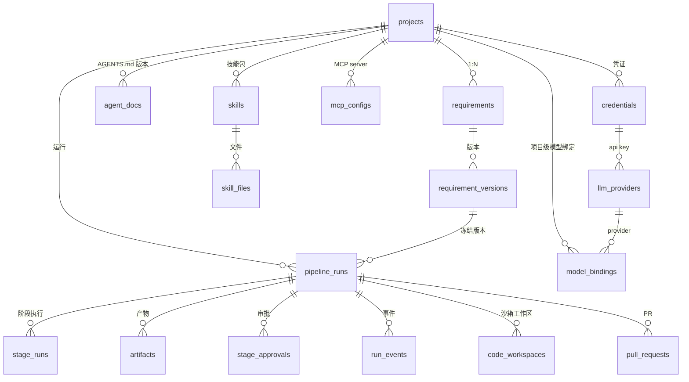

# DevPipeline 架构设计

> AI 辅助软件开发平台：需求录入 → 需求分析 → 系统设计 → 编码 → PR 评审，每个阶段结束停人工审批。
> 本文是 M1 之前的定稿依据；实现偏离本文时，先改本文再改代码。

**目录**

1. [系统概览与职责边界](#1-系统概览与职责边界)
2. [技术选型与理由](#2-技术选型与理由)
3. [LangGraph 状态、节点与人工审批](#3-langgraph-状态节点与人工审批)
4. [MariaDB 业务库 ER](#4-mariadb-业务库-er)
5. [API 契约](#5-api-契约)
6. [前端页面与数据流](#6-前端页面与数据流)
7. [配置：LLM 提供商与每阶段模型](#7-配置llm-提供商与每阶段模型)
8. [仓库结构与依赖](#8-仓库结构与依赖)
9. [里程碑与验收](#9-里程碑与验收)
10. [风险、边界与假设](#10-风险边界与假设)

---

## 1. 系统概览与职责边界

### 1.1 进程拓扑

```mermaid
flowchart LR
  subgraph browser["浏览器"]
    ui["Vue3 + Element Plus 页面"]
    es["EventSource（SSE）"]
  end

  subgraph apip["api 进程 · FastAPI"]
    rest["REST /api/v1"]
    sse["SSE 中继"]
    recon["状态校正 reconciler"]
  end

  subgraph workerp["worker 进程 · arq"]
    graph["LangGraph 执行器"]
    sandbox["沙箱执行器<br/>git worktree / docker"]
    mcp["MCP 客户端"]
  end

  subgraph datalayer["数据层（VPS，docker compose）"]
    maria[("MariaDB 11.4<br/>业务真相")]
    pg[("PostgreSQL 17<br/>checkpointer 表")]
    redis[("Redis 7<br/>队列 + pub/sub")]
  end

  gh["GitHub API"]
  fs["本机工作区磁盘"]

  ui -->|HTTP| rest
  es <-->|SSE| sse
  rest -->|enqueue job| redis
  redis -->|取任务| graph
  graph -->|事件 pub| redis
  redis -->|订阅 run:id:events| sse
  graph -->|读写业务数据| maria
  graph -->|checkpoint| pg
  sse -->|回放 run_events| maria
  recon -->|aget_state| pg
  recon -->|修正状态| maria
  sandbox -->|git / 白名单命令| fs
  graph --> mcp
  graph -->|创建 PR| gh
```

三个进程的职责，不允许互相越界：

| 进程 | 负责 | 明确不负责 |
|---|---|---|
| `api`（FastAPI） | 业务 CRUD、审批落库、任务入队、SSE 中继、状态校正 | 不跑 LangGraph、不执行 shell、不持有沙箱 |
| `worker`（arq） | 跑图、调模型、调 MCP 工具、执行沙箱命令、写 stage/artifact/event | 不对外暴露 HTTP |
| `frontend`（Vite 构建 → Nginx） | 录入、审批、可视化、Diff 展示 | 不做任何业务判定 |

### 1.2 两个数据库的职责边界

| | MariaDB 11.4（业务库） | PostgreSQL 17（流程状态库） |
|---|---|---|
| 存什么 | 项目、需求与版本、AGENTS.md、Skills、MCP 配置、运行记录、阶段产物、审批记录、事件、PR、模型绑定 | **只有** LangGraph checkpointer 表（`checkpoints` / `checkpoint_blobs` / `checkpoint_writes`） |
| 谁写 | `api` 与 `worker` | 只有 `worker` 里的 LangGraph（`AsyncPostgresSaver`） |
| 表从哪来 | Alembic 迁移 | `AsyncPostgresSaver.setup()` 启动时自建，**不进 Alembic** |
| 权威性 | 业务字段权威（标题、文档、人工编辑后的产物） | 流程状态权威（当前节点、待执行的 next、checkpoint 历史） |

两库**唯一关联键**：`pipeline_runs.thread_id`（LangGraph 的 `configurable.thread_id`）与 `pipeline_runs.last_checkpoint_id`。

一致性规则：

1. 不做跨库事务。所有写入必须幂等：`artifacts` 按 `(run_id, stage, version)` upsert，`stage_runs` 按 `(run_id, stage, attempt)` upsert，`run_events` 按 `(run_id, seq)` 去重插入。
2. 写序固定为：先写 checkpoint（LangGraph 内部完成）→ 再写 MariaDB 的 `stage_runs`/`artifacts` → 最后更新 `pipeline_runs.status`。任一步崩溃，下次读到的 MariaDB 状态都落后于图状态，属于可修正的"落后"，而不是矛盾。
3. 读路径上校正：`GET /runs/{id}` 与 worker 启动扫描时比对 `graph.aget_state(config)` 与 MariaDB。以图状态为准改写 `status/current_stage/last_checkpoint_id`，并写 `reconciled_at`。`state.next` 非空且无 pending 审批 → 判定为"需要继续跑"，重新入队。
4. 事件序号 `seq` 用 Redis `INCR run:{run_id}:seq` 生成，跨进程单调；MariaDB 唯一键兜底重复投递。

### 1.3 部署形态

| 形态 | 组成 | 适用 |
|---|---|---|
| A 开发（当前） | VPS 跑三库；本机 conda 跑 `api` + `worker`；前端 `vite dev` | 日常开发，改代码即时生效 |
| B 生产 | VPS 上 compose 起三库 + `api` + `worker` + `frontend` | 部署验证、给别人用 |

**硬约束**：同一次 run 的 `api`（SSE 订阅）与 `worker`（跑图 + 沙箱）必须同机。沙箱工作目录不跨机器共享；允许的远程组合只有「api + worker 同机，MariaDB/PostgreSQL/Redis 远程」，本项目的 A 形态就是这个组合。

远程数据库的现实代价（VPS 通常 20–50 ms RTT）：

- 写路径必须批量：`run_events` 每 200 ms 或每 50 条 flush 一次，绝不逐条 insert。
- 禁止 N+1：列表接口一律 `selectinload` 或显式 join 计数。
- checkpointer 用 **psycopg 连接池**，不开 pipeline：`AsyncPostgresSaver.__init__` 对 `pool + pipe` 会直接 raise（源码强制检查），两者互斥。连接池换来断线重连与并发安全，代价是每次 checkpoint 多几次往返。
- 读路径加短 TTL 缓存（项目配置、AGENTS.md、model_bindings），审批与运行状态**不缓存**。

### 1.4 实测环境基线（2026-10-21 验证）

用户 VPS（`111.229.49.43`）上由 `deploy/docker-compose.yml` 起的三库，已用真实客户端连通并核对：

| 项 | 实测值 | 验证方式 |
|---|---|---|
| MariaDB | `11.4.13-MariaDB-ubu2404`；库 `devpipeline`，`utf8mb4` / `utf8mb4_unicode_ci` | `select version(), @@character_set_database, @@collation_database` |
| 中文 + emoji | 插入 `中文😀` 回读正常，`char_length=3`、`length=10`（3+3+4 字节） | 建临时表插入后回读，表 collation 为 `utf8mb4_unicode_ci` |
| PostgreSQL | `17.11`（alpine），库 `devpipeline_graph`，`UTF8`，`TimeZone=UTC` | `select version()` + `current_database()` |
| Redis | `7.4.11`，`AUTH` 生效，`SET/GET` 中文😀 往返正常 | `PING` + 字符串往返 |
| 端口 | 13306 / 15432 / 16379 / 7741 均从本机可达（RTT 14–34 ms） | TCP 探测 + 客户端连接 |
| Redis Commander | 未带凭据访问返回 **200**（无鉴权） | `curl /`，见 §10.1 风险表 |

结论：M1 可以直接连这套远程库跑 Alembic 与集成测试，不需要本机 Docker。

---

## 2. 技术选型与理由

| 层 | 选择 | 理由 / 代价 |
|---|---|---|
| Web 框架 | FastAPI + Pydantic v2 | 原生 async、OpenAPI 自动生成、SSE 用 `StreamingResponse`/`sse-starlette` 即可 |
| ORM | SQLAlchemy 2.0 async + `asyncmy` | 官方 async 支持；`asyncmy` 比 `aiomysql` 快且维护活跃 |
| 迁移 | Alembic（仅 MariaDB） | PG 侧表归 LangGraph 管，避免两套迁移互相踩 |
| 流程编排 | LangGraph `StateGraph` + `AsyncPostgresSaver` | 内置 `interrupt`/`Command(resume)`、checkpoint 历史，正好覆盖 HITL 与回溯 |
| 模型 | LangChain `ChatOpenAI`（OpenAI 兼容） | 一套客户端支持 DeepSeek 等兼容端点，换 provider 只改配置 |
| MCP | `langchain-mcp-adapters` | stdio 与 streamable HTTP 都由它管，工具自动转成 LangChain Tool |
| 队列 | **arq**（Redis） | 全链路 asyncio；Celery 是同步模型，与 async 图不匹配 |
| 实时推送 | **SSE** | 事件单向；审批走 HTTP POST；断线用 `Last-Event-ID` 回放 |
| 缓存/广播 | Redis 7（AOF） | 队列与 pub/sub 同源，少一个组件 |
| 前端 | Vue3 + Vite + TS + Pinia + Vue Router + **Element Plus** | 表单/表格/抽屉密集，Element Plus 组件覆盖最全 |
| Markdown | `md-editor-v3` | 编辑 + 预览 + 上传一体化 |
| 流程图 | `@vue-flow/core` | 自绘节点状态，数据来自后端图定义 |
| Diff | `monaco-editor`（本地 worker 打包） | 不依赖 CDN，内网可用 |
| 凭证加密 | `cryptography` Fernet（AES-128-CBC + HMAC） | 主密钥来自 `APP_SECRET_KEY`，DB 只存密文与 `key_version` |
| 测试 | pytest + pytest-asyncio + respx；Vitest + @vue/test-utils | 远程 DB 真实集成测试（MariaDB/PG），不用 SQLite 或内存 checkpointer 替代 |

**为什么不把图跑在 api 进程里**：FastAPI 请求生命周期承载不了"几十分钟 + 需要沙箱 + 需要断点续跑"的任务；BackgroundTasks 在进程重启后丢任务，也无法水平扩容。

---

## 3. LangGraph 状态、节点与人工审批

### 3.1 状态定义

`PipelineState` 用 `TypedDict`（`messages` 需要 reducer，Pydantic 模型不方便）：

| 字段 | 类型 | 说明 |
|---|---|---|
| `run_id` / `project_id` / `requirement_id` / `requirement_version_id` | `int` / `str` | 运行标识，贯穿所有节点 |
| `raw_requirement` | `str` | 本次运行冻结的需求正文（不进二次读取，避免运行中人改了需求） |
| `analysis_doc` | `str \| None` | 需求分析产物（Markdown） |
| `design_doc` | `str \| None` | 系统设计产物（Markdown + Mermaid） |
| `code_diff` | `str \| None` | 编码产物（unified diff / patch） |
| `test_report` | `str \| None` | 沙箱内测试输出摘要（Markdown） |
| `review_report` | `str \| None` | PR 评审意见（Markdown） |
| `gate_decisions` | `dict[str, GateDecision]` | 每阶段决策：`decision` / `feedback` / `artifact_id` / `decided_at` |
| `revisions` | `dict[str, int]` | 每阶段被驳回重跑次数 |
| `review_round` / `max_review_rounds` | `int` | 评审→编码回退轮次与上限（默认 2） |
| `focus_feedback` | `str \| None` | 当前要应用的人工意见（重跑时注入 prompt） |
| `agents_md` | `str` | 本次 run 冻结的 AGENTS.md 快照 |
| `skill_index` | `list[SkillRef]` | 技能清单（name/description/entry_path），正文按需读 |
| `mcp_servers` | `dict[str, McpServerConfig]` | MCP 配置快照（凭证在运行时解密注入） |
| `repo` | `RepoConfig` | 仓库地址、基准分支、凭证引用 |
| `model_bindings` | `dict[str, ModelBinding]` | 每阶段 provider/model 快照 |
| `error` | `str \| None` | 失败原因（同时落 `pipeline_runs.error_message`） |
| `messages` | `Annotated[list[AnyMessage], add_messages]` | 编码阶段的多轮工具调用消息 |

设计原则：**一次 run 冻结所有外部输入**（需求正文、AGENTS.md、技能清单、MCP 配置、模型绑定）。运行中你改配置只影响下一次 run，保证 checkpoint 回溯时行为可复现。

### 3.2 节点图

4 个执行节点 + 4 个 gate 节点。gate 节点只做一件事：`interrupt()` 等人；恢复后把决策写进 state，由条件边决定去向。



补充规则：

- gate 节点被驳回时，`revisions[stage] += 1`，并把 `feedback` 与**该阶段上一版产物**一起注入 prompt（"在既有产物上按意见修改"，而不是从零重写）。
- `approved_with_edit` 先用人工编辑后的正文落一个新的 `artifacts` 版本，再放行；下游节点读 state 里被替换后的值。
- `pr_review` 驳回 → 回到 `coding` 时 `review_round += 1`；达到上限后 `error="review_round_exceeded"` 结束，交人工。
- 每个执行节点的 `stage_runs.attempt` = `revisions[stage] + 1`。

### 3.3 审批与恢复

gate 节点内部只写三行：

```python
def gate_analysis(state: PipelineState) -> dict:
    decision = interrupt({
        "stage": "analysis",
        "artifact_id": state["gate_decisions"].get("analysis", {}).get("artifact_id"),
        "summary": "需求分析已完成，请审批",
    })
    return {"gate_decisions": {**state["gate_decisions"], "analysis": decision}}
```

恢复由 worker 执行：

```python
await graph.ainvoke(Command(resume=payload), config={"configurable": {"thread_id": thread_id}})
```

时序：



SSE 中继这一步走 Redis 而不是直连 worker，是因为 `api` 可能有多个副本，而订阅关系必须是「一个 run 的事件扇出到多个浏览器标签页」。

### 3.4 回溯与重跑

三种语义：

| 入口 | 行为 | 用在哪 |
|---|---|---|
| `fork`（`POST /runs/{id}/fork`，`{checkpoint_id, from_stage?}`） | 新建 run + 新 `thread_id`；从目标 checkpoint 取 `channel_values` 作初值，清空 `from_stage` 及其之后的产物与决策，复制之前的 artifacts，然后从 `from_stage` 的节点重新执行 | 想换一种设计、或从"分析通过"那一刻开分支 |
| `pause` / `resume`（`POST /runs/{id}/pause`、`/resume`） | 置 DB `status=paused`，执行器在下一个节点边界停下（checkpoint 已落）；resume 置回 `running` 并用 `continue_run` 入队，`input=None` 从断点继续 | 长时间运行中途让出 worker、人工介入 |
| `retry`（`POST /runs/{id}/retry`） | 同 thread，从失败节点重跑（`aupdate_state` 清理失败标记后入队） | 失败重试，不换产物 |

fork 的实现细节：`aupdate_state(config, seed, as_node=<from_stage 前一个 gate>)` 会让新 thread 的 `next` 指向 `from_stage` 的节点；
`analysis` 是图入口，直接把 seed 作为 input。**`Command(goto=...)` 作为图输入在 LangGraph 1.1.6 实测会被忽略**，不能用它指定入口。

checkpoint 列表来自 `graph.aget_state_history(config, limit=N)`，返回 `checkpoint_id / next / values 摘要 / created_at`，不返回完整 `values`（大文本会撑爆响应）。

### 3.5 事件采集

worker 只订阅 `astream_events(..., version="v2")`，再翻译成统一信封：

| LangChain 事件 | 我们的 `type` | payload |
|---|---|---|
| `on_chain_start`（节点） | `stage_started` | `stage, attempt` |
| `on_chain_end`（节点） | `stage_finished` | `stage, duration_ms` |
| `on_chat_model_stream` | `llm_token` | `stage, text`（按 50 ms 或 200 字符合并，避免事件风暴） |
| `on_chat_model_end` | `usage` | `stage, prompt_tokens, completion_tokens, model` |
| `on_tool_start` | `tool_started` | `name, args 摘要`（>2 KB 截断） |
| `on_tool_end` | `tool_finished` | `name, result 摘要, duration_ms` |
| `get_stream_writer()` 自定义 | `progress` | `stage, message`（节点内自查进度，如"跑了 12 个测试"） |

节点内部不用 `print`/日志代替事件：日志进标准输出（给运维），事件进 `run_events`（给前端）。两者不混。

---

## 4. MariaDB 业务库 ER

### 4.1 关系图

> 落地状态（2026-10-23）：下图是**目标模型**。当前已建 15 张表（projects / requirements /
> requirement_versions / pipeline_runs / stage_runs / artifacts / stage_approvals / run_events /
> agent_docs / skills / skill_files / mcp_configs / credentials / code_workspaces / pull_requests）。
> `llm_providers`、`model_bindings`（多 provider、每阶段模型）尚未建，
> 当前由环境变量提供单一 provider。



### 4.2 通用约定

- 引擎 `InnoDB`；表与列 `DEFAULT CHARSET=utf8mb4 COLLATE=utf8mb4_unicode_ci`（中文 + emoji）。
- 主键统一 `id BIGINT UNSIGNED NOT NULL AUTO_INCREMENT`；外键 **不建**（业务层保证，避免分库/批量删时锁表），但迁移里建索引。
- 时间列 `DATETIME(3) NOT NULL DEFAULT CURRENT_TIMESTAMP(3)`，统一 UTC（`deploy` 里容器 `TZ=UTC`）。
- 大文本（需求、设计、Diff、LLM 输出、事件 payload）一律 `LONGTEXT`。
- JSON 列命名 `*_json`，类型 `LONGTEXT`（MariaDB 的 `JSON` 只是别名），读写都过 Pydantic 校验，不依赖 DB 校验。
- 枚举列用 `VARCHAR(24/32)` + 应用层 Pydantic 枚举，不建 MariaDB `ENUM`（改值要锁表）。

### 4.3 表定义

#### projects — 项目

| 字段 | 类型 | 约束 / 说明 |
|---|---|---|
| `id` | BIGINT UNSIGNED | PK |
| `name` | VARCHAR(128) | NOT NULL |
| `slug` | VARCHAR(64) | NOT NULL, UNIQUE |
| `description` | VARCHAR(512) | NULL |
| `owner_id` | BIGINT UNSIGNED | NULL，本期恒为 NULL，为多用户预留 |
| `status` | VARCHAR(16) | NOT NULL DEFAULT `active`（`active`/`archived`） |
| `created_at` / `updated_at` | DATETIME(3) | NOT NULL |

#### credentials — 加密凭证

| 字段 | 类型 | 约束 / 说明 |
|---|---|---|
| `id` | BIGINT UNSIGNED | PK |
| `project_id` | BIGINT UNSIGNED | NULL = 全局（如 LLM key） |
| `name` | VARCHAR(64) | NOT NULL |
| `kind` | VARCHAR(16) | `git_token` / `llm_api_key` |
| `encrypted_blob` | BLOB | NOT NULL，Fernet 密文 |
| `key_version` | SMALLINT UNSIGNED | NOT NULL DEFAULT 1，主密钥轮换用 |
| `hint` | VARCHAR(32) | NULL，末 4 位掩码，给 UI 显示 |
| `created_at` | DATETIME(3) | NOT NULL |
| 索引 | | UNIQUE(`project_id`, `name`) |

#### agent_docs — AGENTS.md 版本

| 字段 | 类型 | 约束 / 说明 |
|---|---|---|
| `id` | BIGINT UNSIGNED | PK |
| `project_id` | BIGINT UNSIGNED | NOT NULL |
| `version` | INT UNSIGNED | NOT NULL，从 1 递增 |
| `content` | LONGTEXT | NOT NULL |
| `is_active` | TINYINT(1) | NOT NULL DEFAULT 0，每个项目最多一条为 1（业务层保证） |
| `created_by` | VARCHAR(64) | NULL |
| `created_at` | DATETIME(3) | NOT NULL |
| 索引 | | UNIQUE(`project_id`, `version`)，INDEX(`project_id`, `is_active`) |

#### skills — 技能包

| 字段 | 类型 | 约束 / 说明 |
|---|---|---|
| `id` | BIGINT UNSIGNED | PK |
| `project_id` | BIGINT UNSIGNED | NOT NULL |
| `name` | VARCHAR(64) | NOT NULL，取自 SKILL.md frontmatter |
| `description` | VARCHAR(512) | NOT NULL，注入系统提示用的一句话描述 |
| `entry_path` | VARCHAR(255) | NOT NULL DEFAULT `SKILL.md` |
| `storage_dir` | VARCHAR(512) | NOT NULL，解压后的目录（`storage/skills/{project_id}/{skill_id}`） |
| `manifest_json` | LONGTEXT | NULL，文件清单（path/size/sha256），Pydantic 校验 |
| `enabled` | TINYINT(1) | NOT NULL DEFAULT 1 |
| `created_at` / `updated_at` | DATETIME(3) | NOT NULL |
| 索引 | | UNIQUE(`project_id`, `name`) |

#### skill_files — 技能包文本文件

| 字段 | 类型 | 约束 / 说明 |
|---|---|---|
| `id` | BIGINT UNSIGNED | PK |
| `skill_id` | BIGINT UNSIGNED | NOT NULL |
| `path` | VARCHAR(512) | NOT NULL，相对技能根目录 |
| `content` | LONGTEXT | NOT NULL，仅文本文件入库（便于预览与按需读取） |
| `size_bytes` | INT UNSIGNED | NOT NULL |
| `sha256` | CHAR(64) | NOT NULL |
| `created_at` | DATETIME(3) | NOT NULL |
| 索引 | | UNIQUE(`skill_id`, `path`) |

> 二进制文件不入库，只落 `storage_dir` 并在 `manifest_json` 里记录。

#### mcp_configs — MCP server 配置

| 字段 | 类型 | 约束 / 说明 |
|---|---|---|
| `id` | BIGINT UNSIGNED | PK |
| `project_id` | BIGINT UNSIGNED | NOT NULL |
| `name` | VARCHAR(64) | NOT NULL，作为 MCP server 标识 |
| `transport` | VARCHAR(24) | `stdio` / `streamable_http` |
| `config_json` | LONGTEXT | NOT NULL，含 `command/args/env` 或 `url/headers`；凭证写 `"$CRED:{id}"` 占位 |
| `enabled` | TINYINT(1) | NOT NULL DEFAULT 1 |
| `last_test_status` | VARCHAR(16) | NULL（`ok`/`failed`） |
| `last_test_at` | DATETIME(3) | NULL |
| `last_test_message` | VARCHAR(1024) | NULL，工具数量或错误摘要 |
| `created_at` / `updated_at` | DATETIME(3) | NOT NULL |
| 索引 | | UNIQUE(`project_id`, `name`) |

#### requirements — 需求

| 字段 | 类型 | 约束 / 说明 |
|---|---|---|
| `id` | BIGINT UNSIGNED | PK |
| `project_id` | BIGINT UNSIGNED | NOT NULL |
| `title` | VARCHAR(200) | NOT NULL |
| `current_version_no` | INT UNSIGNED | NOT NULL DEFAULT 1 |
| `status` | VARCHAR(24) | `draft`/`queued`/`running`/`waiting_approval`/`done`/`failed`/`cancelled` |
| `latest_run_id` | BIGINT UNSIGNED | NULL |
| `created_at` / `updated_at` | DATETIME(3) | NOT NULL |
| 索引 | | INDEX(`project_id`, `created_at`) |

#### requirement_versions — 需求版本

| 字段 | 类型 | 约束 / 说明 |
|---|---|---|
| `id` | BIGINT UNSIGNED | PK |
| `requirement_id` | BIGINT UNSIGNED | NOT NULL |
| `version_no` | INT UNSIGNED | NOT NULL，从 1 递增 |
| `content` | LONGTEXT | NOT NULL，Markdown 正文 |
| `source` | VARCHAR(16) | `editor`/`upload`/`ai` |
| `note` | VARCHAR(255) | NULL，人工填的变更说明 |
| `created_by` | VARCHAR(64) | NULL |
| `created_at` | DATETIME(3) | NOT NULL |
| 索引 | | UNIQUE(`requirement_id`, `version_no`) |

#### pipeline_runs — 一次流水线运行

| 字段 | 类型 | 约束 / 说明 |
|---|---|---|
| `id` | BIGINT UNSIGNED | PK |
| `project_id` | BIGINT UNSIGNED | NOT NULL |
| `requirement_id` | BIGINT UNSIGNED | NOT NULL |
| `requirement_version_id` | BIGINT UNSIGNED | NOT NULL，冻结的版本 |
| `thread_id` | CHAR(36) | NOT NULL, UNIQUE，LangGraph `thread_id`（两库唯一关联键） |
| `status` | VARCHAR(24) | `queued`/`running`/`waiting_approval`/`succeeded`/`failed`/`cancelled` |
| `current_stage` | VARCHAR(24) | NULL，`analysis`/`design`/`coding`/`review` |
| `last_checkpoint_id` | VARCHAR(64) | NULL，便于跳转回溯 |
| `last_seq` | BIGINT UNSIGNED | NOT NULL DEFAULT 0，SSE 回放起点 |
| `review_round` | SMALLINT UNSIGNED | NOT NULL DEFAULT 0 |
| `max_review_rounds` | SMALLINT UNSIGNED | NOT NULL DEFAULT 2 |
| `model_overrides_json` | LONGTEXT | NULL，本次 run 的模型覆盖 |
| `config_snapshot_json` | LONGTEXT | NULL，AGENTS.md/skills/mcp/repo 的版本与哈希快照 |
| `error_code` | VARCHAR(64) | NULL（`review_round_exceeded`/`sandbox_failed`/`llm_error`/`internal`） |
| `error_message` | TEXT | NULL |
| `reconciled_at` | DATETIME(3) | NULL，最后一次与图状态对齐的时间 |
| `started_at` / `finished_at` | DATETIME(3) | NULL |
| `created_at` / `updated_at` | DATETIME(3) | NOT NULL |
| 索引 | | INDEX(`project_id`, `created_at`)，INDEX(`requirement_id`)，INDEX(`status`) |

#### stage_runs — 阶段执行记录

| 字段 | 类型 | 约束 / 说明 |
|---|---|---|
| `id` | BIGINT UNSIGNED | PK |
| `run_id` | BIGINT UNSIGNED | NOT NULL |
| `stage` | VARCHAR(24) | `analysis`/`design`/`coding`/`review` |
| `attempt` | SMALLINT UNSIGNED | NOT NULL，从 1 起（驳回重跑 +1） |
| `status` | VARCHAR(24) | `running`/`succeeded`/`failed`/`waiting_approval`/`cancelled` |
| `provider` / `model` | VARCHAR(64) / VARCHAR(128) | NULL，实际调用的模型 |
| `prompt_tokens` / `completion_tokens` | INT UNSIGNED | NULL |
| `cost_usd` | DECIMAL(12,6) | NULL，按 provider 单价估算 |
| `duration_ms` | INT UNSIGNED | NULL |
| `feedback` | LONGTEXT | NULL，本次重跑所依据的人工意见 |
| `error_message` | TEXT | NULL |
| `started_at` / `finished_at` | DATETIME(3) | NULL |
| 索引 | | UNIQUE(`run_id`, `stage`, `attempt`) |

#### artifacts — 阶段产物（含人工编辑版本）

| 字段 | 类型 | 约束 / 说明 |
|---|---|---|
| `id` | BIGINT UNSIGNED | PK |
| `run_id` | BIGINT UNSIGNED | NOT NULL |
| `stage` | VARCHAR(24) | NOT NULL |
| `version` | SMALLINT UNSIGNED | NOT NULL，从 1 递增 |
| `kind` | VARCHAR(16) | `markdown`/`diff`/`patch`/`json`/`log`/`test_report` |
| `content` | LONGTEXT | NOT NULL |
| `summary` | VARCHAR(1024) | NULL，一句话摘要（列表用，避免拉全文） |
| `edited_by_human` | TINYINT(1) | NOT NULL DEFAULT 0 |
| `created_at` | DATETIME(3) | NOT NULL |
| 索引 | | UNIQUE(`run_id`, `stage`, `version`) |

#### stage_approvals — 审批记录

| 字段 | 类型 | 约束 / 说明 |
|---|---|---|
| `id` | BIGINT UNSIGNED | PK |
| `run_id` | BIGINT UNSIGNED | NOT NULL |
| `stage` | VARCHAR(24) | NOT NULL |
| `artifact_id` | BIGINT UNSIGNED | NULL，被审批的产物版本 |
| `decision` | VARCHAR(24) | `approved`/`approved_with_edit`/`rejected`/`aborted` |
| `feedback` | LONGTEXT | NULL，驳回意见 |
| `decided_by` | VARCHAR(64) | NULL，本期恒为 `local` |
| `decided_at` | DATETIME(3) | NOT NULL |
| 索引 | | INDEX(`run_id`, `stage`) |

#### run_events — 事件时间线（SSE 回放源）

| 字段 | 类型 | 约束 / 说明 |
|---|---|---|
| `id` | BIGINT UNSIGNED | PK |
| `run_id` | BIGINT UNSIGNED | NOT NULL |
| `seq` | BIGINT UNSIGNED | NOT NULL，Redis `INCR` 生成，全局单调 |
| `stage` | VARCHAR(24) | NULL |
| `type` | VARCHAR(32) | 见 §3.5 |
| `payload` | LONGTEXT | NOT NULL，JSON，Pydantic 校验 |
| `created_at` | DATETIME(3) | NOT NULL |
| 索引 | | UNIQUE(`run_id`, `seq`)，INDEX(`run_id`, `type`) |

#### code_workspaces — 沙箱工作区

| 字段 | 类型 | 约束 / 说明 |
|---|---|---|
| `id` | BIGINT UNSIGNED | PK |
| `run_id` | BIGINT UNSIGNED | NOT NULL |
| `attempt` | SMALLINT UNSIGNED | NOT NULL |
| `mode` | VARCHAR(16) | `worktree`/`docker` |
| `repo_url` | VARCHAR(512) | NOT NULL |
| `workspace_path` | VARCHAR(512) | NOT NULL |
| `branch` | VARCHAR(255) | NOT NULL |
| `base_sha` / `head_sha` | CHAR(40) | NULL |
| `spec_json` | LONGTEXT | NULL，镜像/CPU/内存/超时等 |
| `created_at` | DATETIME(3) | NOT NULL |
| `cleaned_at` | DATETIME(3) | NULL，清理时间；`succeeded` 自动清，失败/取消保留，超保留期由 worker 兜底 |
| 索引 | | INDEX(`run_id`) |

#### pull_requests — PR

| 字段 | 类型 | 约束 / 说明 |
|---|---|---|
| `id` | BIGINT UNSIGNED | PK |
| `run_id` | BIGINT UNSIGNED | NOT NULL |
| `provider` | VARCHAR(16) | `github`/`gitlab` |
| `repo_full_name` | VARCHAR(255) | NOT NULL，`owner/repo` |
| `number` | INT UNSIGNED | NOT NULL |
| `url` | VARCHAR(512) | NOT NULL |
| `branch` / `base_branch` | VARCHAR(255) | NOT NULL |
| `head_sha` | CHAR(40) | NULL |
| `status` | VARCHAR(16) | `open`/`closed`/`merged` |
| `created_at` / `updated_at` | DATETIME(3) | NOT NULL |
| 索引 | | UNIQUE(`run_id`, `provider`) |

#### llm_providers — 模型提供商

| 字段 | 类型 | 约束 / 说明 |
|---|---|---|
| `id` | BIGINT UNSIGNED | PK |
| `name` | VARCHAR(64) | NOT NULL, UNIQUE，如 `deepseek-v4-flash` |
| `endpoint` | VARCHAR(512) | NOT NULL，**完整** chat completions 地址 |
| `model` | VARCHAR(128) | NOT NULL，如 `deepseek-flash` |
| `credential_id` | BIGINT UNSIGNED | NULL，指向 `credentials`；为空则读环境变量 |
| `extra_json` | LONGTEXT | NULL，`temperature`/`max_tokens`/`timeout` 等 |
| `enabled` | TINYINT(1) | NOT NULL DEFAULT 1 |
| `created_at` / `updated_at` | DATETIME(3) | NOT NULL |

#### model_bindings — 每阶段模型绑定

| 字段 | 类型 | 约束 / 说明 |
|---|---|---|
| `id` | BIGINT UNSIGNED | PK |
| `scope` | VARCHAR(16) | `global`/`project` |
| `project_id` | BIGINT UNSIGNED | NOT NULL DEFAULT 0，**0 表示 global**（避免 NULL 破坏唯一键） |
| `stage` | VARCHAR(24) | `analysis`/`design`/`coding`/`review` |
| `provider_id` | BIGINT UNSIGNED | NOT NULL |
| `model` | VARCHAR(128) | NULL，覆盖 provider 默认模型 |
| `params_json` | LONGTEXT | NULL，阶段级参数（如评审用低温度） |
| `created_at` / `updated_at` | DATETIME(3) | NOT NULL |
| 索引 | | UNIQUE(`scope`, `project_id`, `stage`) |

解析顺序：`pipeline_runs.model_overrides_json` → `model_bindings(project)` → `model_bindings(global)` → `llm_providers` 默认值。

### 4.4 Alembic 迁移约定

- 每个迁移显式写 `mysql_charset='utf8mb4'`、`mysql_collate='utf8mb4_unicode_ci'`。
- 大文本列用 `sa.Text().with_variant(mysql.LONGTEXT(), "mysql")`，不裸写 `TEXT`。
- `run_events` 是增长最快的表：按 `run_id` 查，唯一键 `(run_id, seq)` 已是覆盖顺序；不额外加二级索引。M3 之后按需加"保留 N 天"的清理任务。
- 破坏性变更（删列）分两步迁移：先加新列 → 双写 → 再删旧列。

---

## 5. API 契约

### 5.1 通用约定

- 前缀 `/api/v1`（`/healthz`、`/readyz` 不带前缀）。
- 列表分页：`?page=1&page_size=20`，响应 `{items, total, page, page_size}`；`page_size` 上限 100。
- 错误体：`{code, message, details, trace_id}`；HTTP 状态与 `code` 对应（`400 validation_error`、`404 not_found`、`409 conflict`、`422 semantic_error`、`500 internal`）。
- 时间一律 UTC ISO8601（`2026-10-21T06:00:00.000Z`），前端本地化。
- 删除返回 `204`；`PATCH` 只接受声明的字段。
- 本期无鉴权，`decided_by`/`created_by` 固定 `local`；`owner_id` 字段已预留。

### 5.2 端点清单

**系统**

| 方法 | 路径 | 说明 |
|---|---|---|
| GET | `/healthz` | 存活探针，不查依赖 |
| GET | `/readyz` | 就绪探针：MariaDB `SELECT 1`、PG `SELECT 1`、Redis `PING`，任一失败返回 503 |

**项目**

| 方法 | 路径 | 说明 |
|---|---|---|
| GET | `/api/v1/projects` | 分页；支持 `status` 过滤 |
| POST | `/api/v1/projects` | `{name, slug?, description?}`；slug 冲突返回 409 |
| GET | `/api/v1/projects/{project_id}` | 含需求数、最近运行摘要 |
| PATCH | `/api/v1/projects/{project_id}` | `name/description/status` |
| DELETE | `/api/v1/projects/{project_id}` | 有运行记录时返回 409（先归档） |

**AGENTS.md**

| 方法 | 路径 | 说明 |
|---|---|---|
| GET | `/api/v1/projects/{project_id}/agents-md` | 当前生效版本（`content, version, updated_at`） |
| PUT | `/api/v1/projects/{project_id}/agents-md` | `{content}`，新建版本并置为 active |
| GET | `/api/v1/projects/{project_id}/agents-md/versions` | 版本列表（不含正文） |

**Skills**

| 方法 | 路径 | 说明 |
|---|---|---|
| GET | `/api/v1/projects/{project_id}/skills` | 列表（name/description/enabled/文件数） |
| POST | `/api/v1/projects/{project_id}/skills` | `multipart` 上传 zip；校验 SKILL.md、防 zip-slip、大小上限 20 MB |
| GET | `/api/v1/projects/{project_id}/skills/{skill_id}` | 详情 + 文件树 |
| DELETE | `/api/v1/projects/{project_id}/skills/{skill_id}` | 同时删 `storage_dir` |
| GET | `/api/v1/projects/{project_id}/skills/{skill_id}/files/{path:path}` | 单文件内容（文本），二进制返回 415 |

**MCP**

| 方法 | 路径 | 说明 |
|---|---|---|
| GET | `/api/v1/projects/{project_id}/mcp` | 列表；`config_json` 里的凭证已掩码 |
| PUT | `/api/v1/projects/{project_id}/mcp` | 整体覆盖 `{servers: [...]}`；按 name upsert，未出现的删除 |
| POST | `/api/v1/projects/{project_id}/mcp/test` | 连通性测试：每 server 返回 `ok/failed, tools[], error`，超时 15 s |
| DELETE | `/api/v1/projects/{project_id}/mcp/{name}` | 单个删除 |

**仓库与凭证**

| 方法 | 路径 | 说明 |
|---|---|---|
| GET | `/api/v1/projects/{project_id}/repo` | `{repo_url, provider, default_branch, credential_id, credential_hint}` |
| PUT | `/api/v1/projects/{project_id}/repo` | 同上字段（不含 token 明文） |
| POST | `/api/v1/projects/{project_id}/repo/test` | `git ls-remote` 校验地址与凭证 |
| GET | `/api/v1/projects/{project_id}/credentials` | 列表，只返回 `name/kind/hint` |
| POST | `/api/v1/projects/{project_id}/credentials` | `{name, kind, secret}`，加密入库，响应不含明文 |
| DELETE | `/api/v1/projects/{project_id}/credentials/{credential_id}` | 204 |

**需求**

| 方法 | 路径 | 说明 |
|---|---|---|
| GET | `/api/v1/projects/{project_id}/requirements` | 分页 + `q` 标题搜索 |
| POST | `/api/v1/projects/{project_id}/requirements` | `{title, content, note?}`，同时建版本 1 |
| GET | `/api/v1/requirements/{requirement_id}` | 详情 + 当前版本正文 |
| PATCH | `/api/v1/requirements/{requirement_id}` | `title`；正文改动走版本接口 |
| DELETE | `/api/v1/requirements/{requirement_id}` | 有运行记录时 409 |
| GET | `/api/v1/requirements/{requirement_id}/versions` | 版本列表（含 `note/created_at/source`，不含正文） |
| POST | `/api/v1/requirements/{requirement_id}/versions` | `{content, note?}` → 新版本，`current_version_no` +1 |
| POST | `/api/v1/requirements/{requirement_id}/versions/upload` | 上传 `.md`（≤2 MB）→ 新版本 |
| GET | `/api/v1/requirements/{requirement_id}/versions/{version_no}` | 单版本正文 |

**运行**

| 方法 | 路径 | 说明 |
|---|---|---|
| POST | `/api/v1/requirements/{requirement_id}/runs` | `{version_no?, model_overrides?, max_review_rounds?}`；同需求已有活跃 run 时 409 |
| GET | `/api/v1/runs` | 分页；`project_id/status/requirement_id` 过滤 |
| GET | `/api/v1/runs/{run_id}` | 运行详情（含 `pending_approval` 摘要、`usage` 汇总）；读时与图状态校正 |
| POST | `/api/v1/runs/{run_id}/cancel` | 取消：入队取消任务，worker 在下一个节点边界停止；`queued` 直接置 `cancelled` |
| POST | `/api/v1/runs/{run_id}/pause` | 暂停：置 `status=paused`，执行器在下一个节点边界停下；等待审批时 409 |
| POST | `/api/v1/runs/{run_id}/resume` | 继续已暂停的运行：置 `running` 并 `continue_run` 入队，从断点续跑 |
| POST | `/api/v1/runs/{run_id}/retry` | 失败重试：从失败节点重跑，`attempt` +1 |
| POST | `/api/v1/runs/{run_id}/fork` | `{checkpoint_id, from_stage?}`：新建 run 从历史 checkpoint 分叉，见 §3.4 |
| GET | `/api/v1/runs/{run_id}/states` | `aget_state_history` 包装：`[{checkpoint_id, stage, next, created_at, values_summary}]`，`limit` ≤ 50 |
| GET | `/api/v1/runs/{run_id}/pending-approval` | 无待审批返回 204；有则返回 `{stage, artifact_id, payload}` |
| POST | `/api/v1/runs/{run_id}/approval` | `{decision, feedback?, edited_content?}`；非 `waiting_approval` 状态 409 |

**产物 / 事件 / 沙箱**

| 方法 | 路径 | 说明 |
|---|---|---|
| GET | `/api/v1/runs/{run_id}/artifacts` | 列表（`stage/version/kind/summary/edited_by_human`，不含正文） |
| GET | `/api/v1/artifacts/{artifact_id}` | 单产物正文 |
| PATCH | `/api/v1/artifacts/{artifact_id}` | `{content}` 人工编辑 → 生成 `version+1` 且 `edited_by_human=1` |
| GET | `/api/v1/runs/{run_id}/events` | 历史事件：`?after_seq=&types=&page_size=`，最多 1000 条 |
| GET | `/api/v1/runs/{run_id}/stream` | SSE，见 §5.3 |
| GET | `/api/v1/runs/{run_id}/workspaces` | 沙箱工作区列表（路径/分支/SHA/清理状态） |
| DELETE | `/api/v1/runs/{run_id}/workspaces` | 手动清理工作区（只允许终态 run，否则 409） |
| GET | `/api/v1/runs/{run_id}/pull-requests` | PR 列表（provider/number/url/status） |

**配置与图**

| 方法 | 路径 | 说明 |
|---|---|---|
| GET | `/api/v1/providers` | provider 列表；`api_key` 只回 `configured: true/false` |
| POST | `/api/v1/providers` | `{name, endpoint, model, api_key?, extra?}`；env 与 DB 二选一 |
| PATCH | `/api/v1/providers/{provider_id}` | 改 endpoint/model/extra/enabled |
| DELETE | `/api/v1/providers/{provider_id}` | 被 model_bindings 引用时 409 |
| GET | `/api/v1/model-bindings` | `?project_id=` 返回 global + project 两层的合并视图与来源 |
| PUT | `/api/v1/model-bindings` | `{scope, project_id?, stage, provider_id, model?, params?}` 批量 upsert |
| GET | `/api/v1/pipelines/graph` | 节点/边定义（id/label/stage/order），前端画图用；状态由 run 数据叠加 |

合计 59 个端点（不含 OpenAPI 文档本身）。

### 5.3 SSE 协议

`text/event-stream`，事件信封：

```json
{"seq": 1042, "ts": "2026-10-21T06:12:33.412Z", "run_id": 7,
 "stage": "coding", "type": "tool_started",
 "payload": {"name": "run_tests", "args": {"cmd": "pytest -q"}}}
```

- `id` 字段 = `seq`，浏览器断线重连自动带 `Last-Event-ID`。
- 服务端处理顺序：① 按 `Last-Event-ID` 从 `run_events` 回放 `seq > last` 的记录；② 订阅 Redis `run:{run_id}:events` 继续推。两者用 `seq` 去重，保证"回放 + 实时"不重不漏。
- 心跳：每 15 s 发送一行 `: ping`。
- 结束条件：收到 `run_finished`（`succeeded`/`failed`/`cancelled`）后服务端主动关闭；前端不再重连。
- `last_seq` 落库到 `pipeline_runs.last_seq`，用于新开标签页时的起点计算。

事件类型（与 §3.5 一致）：`run_started`、`stage_started`、`stage_finished`、`llm_token`、`llm_message`、`tool_started`、`tool_finished`、`progress`、`usage`、`interrupt`、`decision`、`artifact_saved`、`state_updated`、`error`、`run_finished`。

---

## 6. 前端页面与数据流

### 6.1 路由

| 路由 | 页面 | 依赖接口 |
|---|---|---|
| `/projects` | 项目列表（卡片 + 新建） | `GET/POST /projects` |
| `/projects/:projectId/requirements` | 需求列表 | `GET /projects/{id}/requirements` |
| `/requirements/:requirementId` | 需求详情：md-editor-v3 编辑/预览、上传 `.md`、版本历史抽屉、启动流水线 | 需求/版本接口 + `POST /requirements/{id}/runs` |
| `/projects/:projectId/settings/agents-md` | AGENTS.md 编辑 + 版本切换 | agents-md 接口 |
| `/projects/:projectId/settings/skills` | Skills 上传/列表/文件预览 | skills 接口 |
| `/projects/:projectId/settings/mcp` | MCP JSON 编辑 + 连通性测试结果表 | mcp 接口 |
| `/projects/:projectId/settings/repo` | 仓库地址/分支/凭证 + 每阶段模型绑定 | repo、credentials、model-bindings |
| `/runs` | 运行列表（状态筛选、耗时、token 汇总） | `GET /runs` |
| `/runs/:runId` | 运行详情（图 + 流 + 时间线 + 审批 + 产物） | run 相关全部 + SSE |

### 6.2 运行详情页布局

左上：Vue Flow 流水线图（节点 = 4 阶段 + 4 审批门），节点状态色：待执行灰 / 运行中蓝（脉冲）/ 等待审批橙 / 成功绿 / 失败红。点击节点 → 右侧切到该阶段产物。

右上：实时面板，三个 Tab：
- **流**：LLM token 增量（滚动到底部跟随，用户上滚则暂停跟随）、当前工具调用卡片（名称/参数/结果，结果默认折叠）。
- **时间线**：`run_events` 按 `seq` 排列，可按类型过滤；失败时红色高亮 `error`。
- **状态历史**：`/states` 结果，每条显示 `stage + next + created_at`，提供「从此处 fork」按钮（弹窗填 `from_stage`）。

底部：产物 Tab（Markdown 预览 / 源码 / Monaco Diff / 测试日志）+ 审批抽屉（通过 / 改后通过 / 驳回 + 意见）。审批抽屉在没有待审批项时禁用。

### 6.3 组件

| 组件 | 职责 |
|---|---|
| `PipelineGraph.vue` | Vue Flow 画布，节点/边由 `GET /pipelines/graph` + run 状态合并；节点点击派发事件 |
| `RunStreamPanel.vue` | token 流 + 工具卡片，含"暂停跟随/清屏" |
| `RunTimeline.vue` | 事件时间线，虚拟滚动（事件可达数千条） |
| `StateHistory.vue` | checkpoint 列表 + fork/resume 入口 |
| `ApprovalDrawer.vue` | 决策表单，驳回时 feedback 必填（前端校验 + 后端 422 双保险） |
| `ArtifactViewer.vue` | 按 `kind` 分流：markdown / diff（Monaco）/ json / log |
| `TokenUsage.vue` | 每次 run 与每阶段的 token/耗时汇总 |
| `SkillUploader.vue` | zip 上传、进度、文件树预览 |
| `McpEditor.vue` | JSON 编辑器 + 保存 + 一键测试（结果表） |
| `ModelBindingTable.vue` | 每阶段 provider/model 选择，展示来源（global/project/run 覆盖） |

### 6.4 状态与数据流

Pinia stores：`project`、`requirement`、`run`（当前 run、事件列表、节点状态、审批项）、`settings`（AGENTS.md/skills/mcp/repo/model-bindings）、`provider`。

composables：
- `useRunStream(runId)`：`EventSource` 生命周期、`Last-Event-ID` 断线续传、事件归并（按 `seq` 去重、`llm_token` 拼接）、收到 `run_finished` 关闭并刷新详情。
- `usePipelineGraph(runId)`：图定义 + run 状态 → Vue Flow nodes/edges（`computed`，避免 watch 里改 DOM）。
- `useApproval(runId)`：提交决策、乐观 UI、409 时重新拉 `pending-approval`。
- `useArtifactEditor(artifactId)`：编辑/保存/生成新版本，离开页面前未保存提示。

数据流约束：**页面不自己推断状态**。节点颜色、当前阶段、是否有待审批，全部来自后端字段；前端只在 `llm_token` 的拼接上做本地聚合。

---

## 7. 配置：LLM 提供商与每阶段模型

### 7.1 配置形态（沿用项目既有写法）

```python
LLM_PROVIDERS = {
    'deepseek-v4-flash': {
        'model': 'deepseek-flash',
        'url': 'https://api.deepseek.com/chat/completions',
        'key': env.llm_key_deepseek,   # 环境变量 LLM_KEY_DEEPSEEK
    },
}
```

映射到 `llm_providers` 行：`name='deepseek-v4-flash'`、`endpoint=url`、`model='deepseek-flash'`、密钥取自 `LLM_KEY_DEEPSEEK`（pydantic-settings 大小写不敏感，`llm_key_deepseek` 与 `LLM_KEY_DEEPSEEK` 等价）。

**关键换算**：`url` 是完整 endpoint，`ChatOpenAI` 需要的是 `base_url`。运行时必须剥后缀：

```python
def to_base_url(endpoint: str) -> str:
    return endpoint.removesuffix('/chat/completions').rstrip('/')

llm = ChatOpenAI(
    base_url=to_base_url(cfg.endpoint),   # https://api.deepseek.com
    api_key=key,
    model=cfg.model,                      # deepseek-flash
    temperature=params.temperature,
    streaming=True,
    timeout=cfg.timeout,
)
```

不剥后缀会拼成 `https://api.deepseek.com/chat/completions/chat/completions` → 404。UI 上 `endpoint` 允许粘贴完整地址或 base_url，保存时统一归一化（有 `/chat/completions` 就保留，无则补全）。

### 7.2 密钥来源优先级

1. `credentials` 表（Fernet 密文，`llm_providers.credential_id` 指向）；
2. 环境变量 `LLM_KEY_{NAME}`（`name` 转大写下划线）；
3. 都没有 → provider 标记 `configured=false`，启动 run 前置校验直接 422，不让运行时才炸。

### 7.3 结构化输出的现实约束

OpenAI 兼容端点对 `response_format`/`json_schema` 支持不一致（同类兼容接口上实测过 400 `This response_format type is unavailable now`），因此：

- 需求分析、系统设计、评审三处需要结构化结果时，**不依赖 `with_structured_output`**；
- 统一做法：prompt 要求输出 ```json 代码块 → 提取 → Pydantic 校验 → 失败带错误信息重试 1 次 → 仍失败则把原文作为产物、`error_code=structure_parse_failed` 交人工。

### 7.4 每阶段模型

`model_bindings` 支持 4 个阶段分别绑定 provider/model/参数，默认全用 `deepseek-v4-flash`。解析顺序见 §4.3。前端 `ModelBindingTable` 展示每阶段最终生效值与来源（run 覆盖 / project / global）。

---

## 8. 仓库结构与依赖

### 8.1 目录

```
devpipeline/
├── backend/
│   ├── pyproject.toml
│   ├── alembic.ini
│   ├── alembic/versions/
│   ├── app/
│   │   ├── main.py                  # FastAPI 入口（lifespan：DB/Redis/图初始化）
│   │   ├── core/                    # config(settings) / security(Fernet) / logging / exceptions / middleware
│   │   ├── db/                      # session(MariaDB) / graph_db(PG pool + saver) / base
│   │   ├── models/                  # SQLAlchemy 2.0 声明式模型（17 张表）
│   │   ├── schemas/                 # Pydantic v2 DTO（请求/响应/事件信封）
│   │   ├── api/v1/                  # projects / requirements / runs / artifacts / events / contexts / providers / pipelines
│   │   ├── services/                # 业务编排：run_service / approval_service / event_service / reconciler ...
│   │   ├── agents/
│   │   │   ├── state.py             # PipelineState / GateDecision / 枚举
│   │   │   ├── graph.py             # build_graph()：节点 + 条件边 + checkpointer 注入
│   │   │   ├── llm.py               # provider 解析、base_url 归一化、usage 提取
│   │   │   ├── prompts/             # 各阶段 prompt 模板（含 AGENTS.md/Skills 注入位）
│   │   │   ├── nodes/               # analyze_requirement / design_system / coding / pr_review / gates
│   │   │   ├── mcp.py               # MultiServerMCPClient 装配与工具名去重
│   │   │   └── skills.py            # SKILL.md 解析、按需读取工具
│   │   ├── worker/                  # main.py(arq settings) / tasks.py / streaming.py(事件翻译)
│   │   ├── sandbox/                 # base / worktree / docker / commands(白名单)
│   │   └── vcs/                     # base(Protocol) / github / gitlab(stub) / local_git
│   └── tests/
│       ├── unit/                    # 图路由、prompt 组装、base_url 换算、命令白名单
│       ├── integration/maria/       # 真实 MariaDB（远程）
│       └── integration/pg/          # 真实 PostgreSQL（远程）
├── frontend/
│   ├── package.json / vite.config.ts / vitest.config.ts / tsconfig.json
│   └── src/{main.ts,App.vue,router/,stores/,views/,components/,composables/,api/,styles/}
├── deploy/                          # docker-compose.yml / .env.example / initdb/ / README.md
├── docs/                            # 本文
└── README.md
```

分层约束：`api` 只依赖 `services` 与 `schemas`；`services` 依赖 `models`/`schemas`/`db`；`agents` 可依赖 `models`/`services`（写产物）但**不得**依赖 `api`；`worker` 依赖 `agents` + `services` + `sandbox` + `vcs`。反向依赖一律视为设计错误。

### 8.2 后端依赖（后端环境：conda `devpipeline`，Python 3.11.17）

| 包 | 版本约束 | 用途 |
|---|---|---|
| `fastapi` | `>=0.135,<0.160` | Web 框架 |
| `uvicorn[standard]` | `>=0.31,<0.32` | ASGI server（**上限卡 0.31.x**：0.36+ 在 Windows 用 `asyncio.Runner(loop_factory=...)` 强制 Proactor，会让 psycopg 报 "cannot use the ProactorEventLoop"，另一个项目已实测复现） |
| `pydantic` / `pydantic-settings` | `>=2.11,<3` | DTO 与配置 |
| `sqlalchemy[asyncio]` | `>=2.1,<2.2` | ORM |
| `asyncmy` | `>=0.2.16,<0.3` | MariaDB async 驱动 |
| `alembic` | `>=1.20,<2` | 迁移 |
| `psycopg[binary,pool]` | `>=3.3,<4` | PG 驱动（checkpointer 用） |
| `langgraph` | `>=1.1.6,<2` | 编排（`interrupt`/`Command`/`aget_state_history` 已在本机 1.1.6 核对签名） |
| `langgraph-checkpoint-postgres` | `>=3.1,<4` | `AsyncPostgresSaver`（用 psycopg 连接池；pipeline 模式与连接池互斥） |
| `langchain-core` / `langchain-openai` | 与 langgraph 配套 | 模型调用 |
| `langchain-mcp-adapters` | `>=0.3.2,<0.4` | MCP 工具（会拉 `langchain-core>=1.3.3`） |
| `mcp` | 随 adapters | MCP 协议 |
| `redis` | `>=5.2,<6` | 队列与 pub/sub。**不能装 6.x**：arq 0.28 仍锁 `redis[hiredis]>=4.2,<6`（uv 实测解析无解），redis-py 5.3 连 Redis 7.4 服务端正常 |
| `arq` | `>=0.28,<0.29` | worker |
| `sse-starlette` | `>=2,<3` | SSE（含 `Last-Event-ID` 处理与心跳） |
| `cryptography` | `>=44` | Fernet 加密凭证 |
| `python-multipart` | 随 FastAPI | 文件上传 |
| `httpx` | `>=0.28,<1` | 出站（GitHub REST PR 创建/查询、仓库连通性）；PR 不用 PyGithub，避免同步实现与 respx 不可测 |
| `pytest` / `pytest-asyncio` / `respx` | `>=8` / `>=0.24` / `>=0.22` | 测试（GitHub API 用 respx 回放，不需要真 token） |

安装（M1 执行）：

```powershell
conda run -n devpipeline python -m pip install -e "backend[dev]"
# PyPI 慢时可加一次性镜像参数：-i https://pypi.tuna.tsinghua.edu.cn/simple
```

> Windows 本地开发注意：psycopg 需要 selector 事件循环。uvicorn 0.31.x 在 `use_subprocess=False` 时不改 policy，`asyncio.set_event_loop_policy(WindowsSelectorEventLoopPolicy())` 由应用自己设；`pytest-asyncio` 的 `event_loop_policy` fixture 同样设成 selector。

### 8.3 前端依赖

| 包 | 版本约束 | 用途 |
|---|---|---|
| `vue` / `vue-router` / `pinia` | `^3.5` / `^4.5` / `^3` | 框架 |
| `element-plus` + `@element-plus/icons-vue` | `^2` | UI |
| `md-editor-v3` | `^6` | Markdown 编辑/预览 |
| `@vue-flow/core` + `background` + `controls` + `minimap` | `^1.4x` | 流水线图 |
| `monaco-editor` | `^0.5x` | Diff/代码（走 `vite-plugin-monaco-editor` 或 worker 手动注册，本地打包） |
| `axios` | `^1` | HTTP |
| `dayjs` | `^1` | 时间本地化 |
| `vite` / `typescript` / `vue-tsc` | `^7` / `~5.9` / `^3` | 构建 |
| `vitest` / `@vue/test-utils` / `jsdom` | `^3` / `^2` / `^26` | 测试 |

---

## 9. 里程碑与验收

每个里程碑结束都必须能"起得来 + 跑得通 + 有测试"，验收命令在本文更新时同步维护。

### M1 脚手架 + 需求管理（MariaDB）

范围：后端 `config/db/models/schemas/api/services` 骨架、Alembic 初始迁移、项目与需求 CRUD、需求版本与 `.md` 上传；前端项目列表/需求列表/需求详情（编辑器 + 版本历史）；`GET /healthz` `/readyz`。

验收：
```bash
conda run -n devpipeline alembic upgrade head          # 期望：迁移执行到 head，无报错
conda run -n devpipeline pytest tests/unit -q          # 期望：全绿
conda run -n devpipeline pytest tests/integration/maria -q   # 期望：全绿（连远程 MariaDB）
cd frontend && pnpm build && pnpm test                 # 期望：构建成功，Vitest 全绿
```
手工：建项目 → 建需求 → 编辑保存（产生 v2）→ 上传 `.md`（v3）→ 回滚查看 v1。

### M2 LangGraph 流水线 + 人工审批（PG checkpointer）

范围：`state.py`/`graph.py`/4 节点 + 4 gate、`AsyncPostgresSaver` 装配（`setup()` + psycopg 连接池）、run 启动与审批 API、`stage_runs`/`artifacts`/`stage_approvals` 落库、reconciler。

验收：
```bash
conda run -n devpipeline pytest tests/integration/pg -q      # 期望：全绿（真实 PG，不用内存 saver）
curl -s -X POST localhost:8000/api/v1/requirements/1/runs -H 'content-type: application/json' -d '{}'
# 期望：202 + run 进入 running，随后 waiting_approval
curl -s localhost:8000/api/v1/runs/1/pending-approval        # 期望：200 + stage=analysis
curl -s -X POST localhost:8000/api/v1/runs/1/approval -d '{"decision":"approved"}' -H 'content-type: application/json'
# 期望：202，run 进入 design
```
故障注入：审批后立刻 `kill` worker → 重启 worker → `GET /runs/1` 应自动校正为 `running` 并继续，`reconciled_at` 非空。

### M3 实时可观测性

范围：arq worker + `astream_events` 翻译 + Redis pub/sub + SSE 中继 + `run_events` 批量落库；Vue Flow 实时图、时间线、token/工具面板、取消/暂停/重试、`/states` + fork 重跑。

落地状态（2026-10-23）：SSE / 事件 / 取消 / 暂停 / 继续 / checkpoint fork 均已完成；前端运行详情支持暂停继续按钮与「从此处 fork」弹窗。

验收：
```bash
conda run -n devpipeline python worker.py                    # 另开一个终端
curl -N localhost:8000/api/v1/runs/1/stream                   # 期望：先回放历史，再实时推 llm_token
conda run -n devpipeline pytest tests/integration/pg/test_pause_fork.py -q   # 暂停边界 / 恢复 / fork
```
期望：首个事件 < 1 s；断网 5 s 后重连不重复（`seq` 连续）；`run_finished` 后连接关闭；取消后 worker 在下一个节点边界停止并落 `cancelled`；
暂停在节点边界停住并发 `run_paused`，继续后从断点续跑；fork 的新 run 继承前序 artifact 并从 `from_stage` 重新执行。

### M4 AGENTS.md / Skills / MCP

范围：三块配置的 CRUD 与页面；AGENTS.md 注入系统提示；Skills zip 上传（防 zip-slip、大小上限）、SKILL.md 索引注入 + 按需读取工具；MCP 装配（stdio/streamable_http）、工具名去重（冲突加 `mcp_` 前缀）、连通性测试接口。

验收：
```bash
conda run -n devpipeline pytest tests/unit/test_skills_zip.py tests/unit/test_mcp_naming.py -q
curl -s -X POST localhost:8000/api/v1/projects/1/mcp/test -H 'content-type: application/json' \
  -d '{"servers":[{"name":"fs","transport":"stdio","config":{"command":"npx","args":["-y","@modelcontextprotocol/server-filesystem","."]}}]}'
# 期望：{"results":[{"name":"fs","ok":true,"tools":[...]}]}
```
恶意 zip（`../../evil.sh`）必须被拒绝并 400，且磁盘上无残留文件。

### M5 编码沙箱 + PR 评审

范围：`git worktree` 模式（默认）+ Docker 模式（后续）；白名单命令执行器（超时、输出截断）；
`code_workspaces`/`pull_requests`；评审前推送分支 + 创建/复用 GitHub PR；评审驳回 → 编码回退受
`max_review_rounds` 约束。

落地状态（2026-10-23）：worktree 沙箱、命令白名单、PR 创建与 API、工作区清理均已完成；Docker 模式未做。
PR 客户端 `app/vcs/`（Protocol + httpx GitHub 实现，GitLab 仅抛错占位）。
工作区清理由 `app/services/workspace_service.py` 负责：成功即清、失败保留、保留期兜底（worker 每日 cron）。

验收：
```bash
# 沙箱流程（worktree 模式，本机需 git）
conda run -n devpipeline pytest tests/integration/pg/test_sandbox_pipeline.py -q
# PR：commit + push（本地裸仓库）+ 幂等落库 + 事件 + API
conda run -n devpipeline pytest tests/integration/pg/test_pull_request_pipeline.py -q
# GitHub REST 客户端（respx 回放：创建、已存在 422 回查、鉴权失败）
conda run -n devpipeline pytest tests/unit/test_vcs_github.py -q
# 工作区清理：成功自动清、失败保留、保留期/孤儿兜底、手动 API（409/幂等）
conda run -n devpipeline pytest tests/integration/pg/test_workspace_cleanup.py -q
```
期望：`max_review_rounds=2` 时，第 3 次驳回后 run 终止为 `failed`，`error_code=review_round_exceeded`，且不再调用模型。

### 本机能验证 / 必须你验证

| 项 | 我这边（本机） | 你那边（VPS） |
|---|---|---|
| 单元测试、类型检查、前端构建与 Vitest | ✅ | — |
| MariaDB/PG 集成测试 | ✅ 已连远程实例跑通 | 可复跑 |
| `docker compose up` 与健康检查 | ❌ | ✅ |
| 真实 LLM 调用 | ⚠️ 无 key，用 fake provider | ✅ 填 `LLM_KEY_DEEPSEEK` |
| GitHub PR | ⚠️ respx 回放 + 本地裸仓库 push；无真 token | ✅ 配 `repo_url` + 凭证后真建 PR |

---

## 10. 风险、边界与假设

### 10.1 已知风险

| 风险 | 影响 | 缓解 |
|---|---|---|
| 三库公网明文连接 | 凭证与数据在传输中可被嗅探 | 强密码 + 安全组白名单（或 SSH 隧道）；TLS 列为后续 |
| VPS RTT 20–50 ms | 运行耗时偏高、事件落库变慢 | 批量写、禁 N+1、连接池复用、配置短 TTL 缓存 |
| LangGraph 版本漂移（本机 1.1.6，PyPI 1.2.16） | 升级可能改签名/事件名 | 锁 `>=1.1.6,<2`，M2 开工前用已装环境再核对一次 |
| 兼容端点不支持 `response_format` | 结构化解析失败 | JSON 代码块 + Pydantic 校验 + 一次重试，不依赖 `with_structured_output` |
| 沙箱在 Windows 本机 | Docker 不可用，只有 worktree 模式可验 | 默认 worktree；Docker 模式代码写好，等有 Docker 的环境验证 |
| 编码 Agent 执行命令 | 破坏本机/仓库 | 白名单命令 + 超时 + 输出截断 + 独立 worktree + 危险命令直接拒绝 |
| 事件表膨胀 | `run_events` 增长快 | 唯一键 `(run_id, seq)`，M3 后加保留期清理任务 |
| Redis Commander 面板无鉴权 | 公网任何人可浏览/改写 Redis（实测未带凭据访问返回 200） | compose 已强制 basic auth（`REDIS_COMMANDER_PASSWORD` 必填）；建议改绑 `127.0.0.1` 走 SSH 隧道，或 ufw 只放行自己 IP |

### 10.2 本期不做（明确排除）

- 多用户与鉴权/RBAC（表里预留 `owner_id`，接口固定 `local`）
- `AsyncPostgresStore` 长期记忆（`build_graph(store=None)` 留注入口）
- Langfuse / LangSmith 追踪（事件层已留 `usage`，接 SDK 即可）
- GitLab 实现（`vcs/base.py` 用 Protocol 抽象，`gitlab.py` 只留 stub）
- DB 传输 TLS
- 多副本 `api` 的水平扩容（SSE 中继已按 Redis 扇出设计，但 `api` 无状态化未验证）

### 10.3 假设

- 单用户、无登录；`decided_by/created_by` 恒为 `local`。
- 需求录入只支持 Markdown（编辑器 + `.md` 上传）；技能包只支持 zip（含 `SKILL.md`）。
- 一次 run 冻结所有上下文；运行中改配置只影响下一次 run。
- 沙箱默认 `git worktree`，Docker 模式为可选实现；两者产出同样的 diff 产物格式。
- 本地端口：API 8000、前端 5173（dev）/ 80（生产）；VPS 端口：13306 / 15432 / 16379，Redis Commander 面板 7741（basic auth，仅运维用）。
- 时区：DB 存 UTC，前端按浏览器时区展示。
